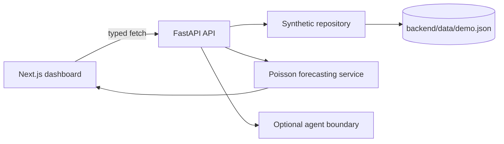

# MatchLens AI

MatchLens AI is a local-first football intelligence dashboard for the Microsoft + Premier League Inside the Game Developer Hackathon. It turns deterministic, clearly synthetic match data into explainable forecasts, player insights, form analysis, and a replayable match narrative.

> All teams, players, fixtures, events, and historical records in this repository are fictional synthetic data. They are not Premier League records.

## Stack and architecture

- Frontend: Next.js App Router, React, TypeScript, Tailwind CSS, Recharts, Lucide
- Backend: Python 3.11+, FastAPI, Pydantic, NumPy, SciPy
- Model: explainable Poisson scoreline model with form, attack, defence, home advantage, and live remaining-time conditioning
- Future boundary: `backend/app/agents/` contains typed payloads and service interfaces for optional Microsoft Foundry agents.



## Run locally

```bash
cd backend && python3 -m venv .venv && source .venv/bin/activate
pip install -r requirements.txt
python scripts/generate_data.py
uvicorn app.main:app --reload --port 8000
```

In another terminal:

```bash
cd frontend
npm install
cp .env.example .env.local
npm run dev
```

Open `http://localhost:3000`; OpenAPI is at `http://localhost:8000/docs`.

## API and model

The API exposes health, fixtures, match details, H2H, form, players, forecasts, and ordered events under `/api`. The frontend reads all statistics through `src/lib/api.ts`.

The forecast combines synthetic attack, opponent defence, home advantage, and five-match form into expected goals. Poisson scoreline probabilities over 0–7 goals produce normalized home/draw/away probabilities and likely scorelines. During replay, recorded goals are fixed and only remaining-time goals are simulated. This is a transparent demo model, not a validated real-world predictor.

## Phase 2 agent workflow

`POST /api/analysis` runs Investigator → Predictor → Insight. In the default `AGENT_MODE=mock`, all three stages are deterministic local Python code and call the validated tools in `backend/app/agents/tools.py`; no Foundry network calls are made. The response includes evidence record IDs, forecast payloads, audience-specific insight, tool-call telemetry, and mode.

For live Foundry mode, install optional dependencies with `pip install -r requirements-foundry.txt`, authenticate with Azure CLI (`az login`), and set the variables in `backend/.env.example`. Each Prompt Agent requires its own explicit `*_VERSION`; the adapter never silently selects latest and never falls back to mock mode. It fails clearly if the SDK, endpoint, agent names, permissions, or structured response are unavailable.

Prompt Agent function definitions must be registered on the Foundry agent before local callables can execute. Review a dry-run schema with:

```bash
cd backend
python scripts/register_foundry_tools.py --inspect   # read-only existing definitions
python scripts/register_foundry_tools.py --dry-run   # default; human-readable diff
python scripts/register_foundry_tools.py --apply     # explicit remote version creation
```

The setup script does not run automatically and never provisions Azure resources. It retrieves existing definitions first, preserves model and complete instructions, refuses incomplete snapshots, and records old versions for rollback by repointing the `*_VERSION` variables. `requirements-foundry.txt` uses the current `agent-framework-foundry`, `azure-identity`, and `azure-ai-projects` packages. The current Microsoft guidance notes that function-call runs expire after 10 minutes and that local callables must match pre-registered Prompt Agent function definitions.

The evaluation prompts are in `backend/evaluations/analysis_questions.json`. They are local fixtures only; no live Foundry evaluation or trace has been claimed.

For an isolated Investigator diagnostic, use the opt-in script below. It makes no network call unless `--confirm-live` is explicitly supplied, and defaults to one bounded attempt with a 30-second timeout:

```bash
cd backend
source .venv/bin/activate
set -a && source .env && set +a
python scripts/diagnose_foundry_investigator.py --confirm-live --timeout 30 --retries 0
```

Foundry diagnostics emit correlation IDs, elapsed times, agent/version boundaries, local tool execution, and failure stages without logging credentials, authorization headers, or request payloads. `AGENT_MODE=mock` remains the default for local development.

## Tests and limitations

```bash
cd backend && PYTHONPATH=. pytest
cd frontend && npm run lint && npm run typecheck && npm run build
```

The app avoids club logos, copyrighted footage, scraping, cloud credentials, and accuracy claims. Audience summaries are deterministic templates backed by the same evidence and are ready to be replaced by Foundry agent execution later.

## Next phase

Add Microsoft Foundry tool adapters behind the existing agent contracts, richer scenario simulation, persistent user preferences, model evaluation on a labelled dataset, and streaming live-event ingestion.
