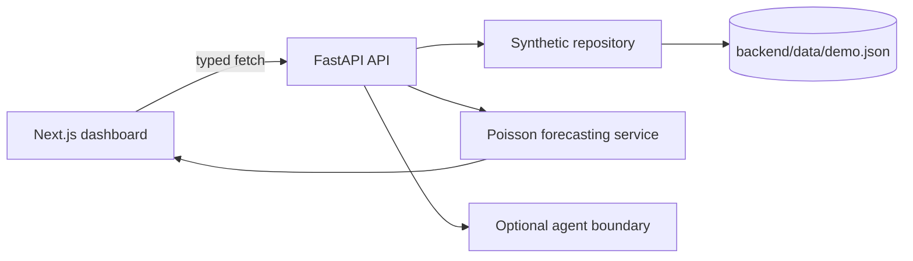

# MatchLens AI

MatchLens AI is a local-first football intelligence dashboard for the Microsoft + Premier League Inside the Game Developer Hackathon. It turns deterministic, clearly synthetic match data into explainable forecasts, player insights, form analysis, and a replayable match narrative.

> All teams, players, fixtures, events, and historical records in this repository are fictional synthetic data. They are not Premier League records.

## Stack and architecture

- Frontend: Next.js App Router, React, TypeScript, Tailwind CSS, Recharts, Lucide
- Backend: Python 3.11+, FastAPI, Pydantic, NumPy, SciPy
- Model: explainable Poisson scoreline model with form, attack, defence, home advantage, and live remaining-time conditioning
- Agent workflow: Microsoft Foundry Prompt Agents orchestrated by the Microsoft Agent Framework, with local Python function dispatch and strict Pydantic handoffs.



## Run locally

```bash
cd backend && python3 -m venv .venv && source .venv/bin/activate
pip install -r requirements.txt
python scripts/generate_data.py
uvicorn app.main:app --reload --port 8000
```

In another terminal:

```bash
cd frontend
npm install
cp .env.example .env.local
npm run dev
```

Open `http://localhost:3000`; OpenAPI is at `http://localhost:8000/docs`.

## API and model

The API exposes health, fixtures, match details, H2H, form, players, forecasts, and ordered events under `/api`. The frontend reads all statistics through `src/lib/api.ts`.

The forecast combines synthetic attack, opponent defence, home advantage, and five-match form into expected goals. Poisson scoreline probabilities over 0–7 goals produce normalized home/draw/away probabilities and likely scorelines. During replay, recorded goals are fixed and only remaining-time goals are simulated. This is a transparent demo model, not a validated real-world predictor.

## Phase 2 agent workflow

`POST /api/analysis` runs Investigator → Predictor → Insight. In the default `AGENT_MODE=mock`, all three stages are deterministic local Python code and call the validated tools in `backend/app/agents/tools.py`; no Foundry network calls are made. In `AGENT_MODE=foundry`, the verified versions are Investigator v8, Predictor v6, and Insight v5. The response includes evidence record IDs, forecast payloads, audience-specific insight, tool-call telemetry, agent traces, and mode.

For live Foundry mode, install optional dependencies with `pip install -r requirements-foundry.txt`, authenticate with Azure CLI (`az login`), and set the variables in `backend/.env.example`. Each Prompt Agent requires its own explicit `*_VERSION`; the adapter never silently selects latest and never falls back to mock mode. It fails clearly if the SDK, endpoint, agent names, permissions, or structured response are unavailable.

Prompt Agent function definitions must be registered on the Foundry agent before local callables can execute. Review a dry-run schema with:

```bash
cd backend
python scripts/register_foundry_tools.py --inspect   # read-only existing definitions
python scripts/register_foundry_tools.py --dry-run   # default; human-readable diff
python scripts/register_foundry_tools.py --apply     # explicit remote version creation
```

The setup script does not run automatically and never provisions Azure resources. It retrieves existing definitions first, preserves model and complete instructions, refuses incomplete snapshots, and records old versions for rollback by repointing the `*_VERSION` variables. `requirements-foundry.txt` uses the current `agent-framework-foundry`, `azure-identity`, and `azure-ai-projects` packages. The current Microsoft guidance notes that function-call runs expire after 10 minutes and that local callables must match pre-registered Prompt Agent function definitions.

The evaluation prompts are in `backend/evaluations/analysis_questions.json`. They are local fixtures only; no live Foundry evaluation or trace has been claimed.

## Experience Microsoft Foundry Live

The public site defaults to **Demo Mode**. Judges can intentionally opt into the real, server-side Investigator → Predictor → Insight workflow by selecting **Microsoft Foundry Live**, opening the GitHub access guide, and entering this publicly shared demo GUID:

```text
B106165E-873C-4007-B035-471F7BBAA07E
```

This GUID is an opt-in demo gate, not secure authentication or identity verification. It is never placed in a URL or frontend build output. The public backend must separately have `FOUNDRY_PUBLIC_ENABLED=true`, the matching `FOUNDRY_PUBLIC_ACCESS_GUID`, and the pinned Foundry versions. Until those settings are present, Demo Mode remains the only available mode.

Public Live mode is restricted to the verified `match-001` fixture by default, uses the existing per-IP analysis rate limiter, limits questions to 300 characters, and performs no automatic retries. Set `FOUNDRY_PUBLIC_ENABLED=false` to shut off live inference without affecting Demo Mode.

The live response identifies the actual execution mode and retains Investigator evidence IDs, Predictor values and player projections, Insight limitations, agent versions, and Python tool provenance. All data remains synthetic and Foundry explanations still require human review. Because the access GUID is intentionally public, this rate limiter is a practical demo safeguard rather than strong authentication or a hard global spending cap.

Production requires the Container App system-assigned managed identity to have only the Foundry **Foundry Agent Consumer** role at the project or agent scope. The runtime does not need Owner, Contributor, or Foundry project-management permissions. Microsoft documents Foundry Agent Consumer as the least-privilege role for invoking agent endpoints ([RBAC guidance](https://learn.microsoft.com/en-us/azure/ai-foundry/concepts/rbac-ai-foundry)) and recommends a specific managed identity credential in production ([Agent Framework Foundry guidance](https://learn.microsoft.com/en-us/agent-framework/integrations/by-component/agent-services/foundry)).

For an isolated Investigator diagnostic, use the opt-in script below. It makes no network call unless `--confirm-live` is explicitly supplied, and defaults to one bounded attempt with a 30-second timeout:

```bash
cd backend
source .venv/bin/activate
set -a && source .env && set +a
python scripts/diagnose_foundry_investigator.py --confirm-live --timeout 30 --retries 0
```

Foundry diagnostics emit correlation IDs, elapsed times, agent/version boundaries, local tool execution, and failure stages without logging credentials, authorization headers, or request payloads. `AGENT_MODE=mock` remains the default for local development.

## Tests and limitations

```bash
cd backend && PYTHONPATH=. pytest
cd frontend && npm run lint && npm run typecheck && npm run build
```

The app avoids club logos, copyrighted footage, scraping, cloud credentials, and accuracy claims. Synthetic replay and forecasts remain deterministic; Foundry inference is explicit, server-side, bounded, and protected by an analysis rate limit. Public deployments should keep `AGENT_MODE=mock` unless authenticated access and Azure cost controls are in place.

## Frontend integration and deployment preparation

The Next.js client is a static export and reads its backend from `NEXT_PUBLIC_API_URL`. It renders the real analysis response: Investigator evidence and missing information, Python forecast values, player projections, Insight prose, mode, agent stages, and tool provenance. Replay changes call only the deterministic forecast endpoint; the paid three-agent workflow runs only after the user presses **Analyze match**.

Local environment examples:

```bash
cp frontend/.env.example frontend/.env.local
# Set NEXT_PUBLIC_API_URL to the FastAPI /api URL.
```

The backend accepts comma-separated `CORS_ORIGINS` and limits `/api/analysis` to `ANALYSIS_RATE_LIMIT_PER_MINUTE` requests per client per minute. These are practical single-container protections, not a replacement for an authenticated gateway in production.

Build deployment artifacts without creating Azure resources:

```bash
cd frontend
cp .env.production.example .env.production
# Replace NEXT_PUBLIC_API_URL with the deployed FastAPI /api URL.
npm run build
cd ../backend && docker build -t matchlens-api .
```

The production export must be built with `NEXT_PUBLIC_API_URL` set; the build fails closed when it is missing. `frontend/out/staticwebapp.config.json` is emitted from `frontend/public/staticwebapp.config.json`, and the exported app must not contain a localhost API URL. Configure the deployed backend's `CORS_ORIGINS` with the exact Static Web Apps origin, for example `https://<app-name>.azurestaticapps.net`, plus any local development origin you need.

The backend Dockerfile includes synthetic `data/demo.json`, listens on `$PORT`, and runs with `AGENT_MODE=mock` by default. Before deployment, smoke-test `/api/health` and one `/api/analysis` request inside the image. No public URL or Azure resource is claimed by this repository.

## Hackathon pitch

MatchLens AI turns synthetic football events into intelligence people can actually understand. A deterministic Python forecasting engine calculates the probabilities; a Microsoft Foundry Investigator gathers grounded evidence; a Predictor preserves the numerical forecast; and an Insight agent explains the result for fans, analysts, or fantasy players. The dashboard makes that chain visible instead of hiding it behind a chatbot: users can replay a match, inspect changing probabilities, ask a focused question, and trace the answer back to evidence IDs and Python tool calls. The result is a judge-friendly demonstration of multi-agent orchestration with a clear trust boundary—synthetic data is labelled, model output is not presented as certainty, and unavailable information is shown. Mock mode keeps the public demo low-cost, while an explicit server-side Foundry mode proves the same workflow can run with real agents.

## Two-minute demo sequence

1. Start on the Match Command Centre and point out the synthetic-data label, score, expected goals, and win probabilities.
2. Move the replay slider through a goal and show the score and deterministic forecast changing without invoking Foundry.
3. Switch Fan, Analyst, and Fantasy lenses to show the different emphasis.
4. Ask “Why is the home team favored?” and show Investigator → Predictor → Insight, evidence IDs, tool activity, and uncertainty.
5. Open the player intelligence panel to show the synthetic projections and finish on the explanation’s trust boundary.

## Current limitations

- The data is fictional and synthetic; it is not official Premier League data.
- Foundry mode requires Azure credentials, configured agent versions, and incurs model inference cost.
- Semantic review is still appropriate for AI-generated explanations even when schema and numerical checks pass.
- Azure resources are configuration-ready only; deployment and public endpoints must be provisioned and verified separately.

## Next phase

Add Microsoft Foundry tool adapters behind the existing agent contracts, richer scenario simulation, persistent user preferences, model evaluation on a labelled dataset, and streaming live-event ingestion.
